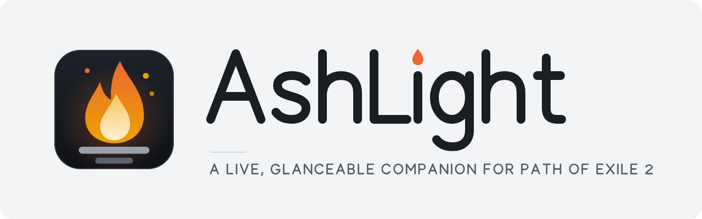

# AshLight

<picture>
  <source media="(prefers-color-scheme: dark)" srcset="assets/brand/readme-hero-dark.png">
  
</picture>

A second-screen dashboard and quiet overlay for your Path of Exile 2 session.

AshLight follows the game's own log file (`Client.txt`) and shows the few things
worth a glance: the zone you are in and how long you have been there, your
character level, deaths this session, session time, and incoming whispers and
trade requests. It also reads your Path of Building build and checks items
against it. It runs on your own computer, on `127.0.0.1` only.

## What AshLight never does

- It never reads or writes game memory, injects anything, hooks graphics, or
  touches network traffic.
- It never modifies any game file and never writes into your game folders: a
  file it makes for the game (a `.build` guide, a loot filter add-on) goes to
  your browser's downloads, and you move it yourself.
- It never sends input to the game: no keys, no mouse, no chat, no macros, not
  even a synthesized copy shortcut. You play; AshLight only reads.
- It reads `Client.txt` only after you say yes, and shows a visible
  "reading Client.txt" indicator while it does. You can stop it at any time.
- It reads the clipboard once each time you press the item check hotkey, never
  on a timer and never by watching the clipboard. It writes to the clipboard
  only when you click a Copy button.
- It never asks for or stores your account, password or session cookie.

## What it shows

On the dashboard (the overlay shows the first three in a small corner box):

- Zone, zone timer, level, deaths and session time, live from the log.
- Trade requests and whispers, cleared after 10 minutes or when the trade
  closes.
- Item check: hover an item, press Ctrl+C, then the item check hotkey
  (Alt+Shift+E); a verdict against your build for 20 seconds, with editable
  stat weights, an upgrade search and a trade-site link you open yourself.
- Price: the item's poe.ninja value and its price against its points (web
  data on).
- Act times and zone levels for the campaign, maps run with time and deaths,
  a death recap, run history with your best act times, and a last-session
  summary.
- Recent events: zones, level-ups, deaths and whispers.
- Build: paste a Path of Building code or share link to see key stats, damage
  by skill, gear, skills, passive tree and notes; copy the code back, or save a
  `.build` file the game can load as a guide.
- Build health: defence and sustain numbers and what to look for next on each
  slot.
- Search strings for the in-game stash and vendor search, and a loot filter
  add-on that enlarges rare drops of your build's item bases.
- Prices and web data: currency values, price movers this week, and a price
  watch list (web data on).
- Tools: overlay position and size, moving settings to another computer, and
  suggested graphics settings for this computer (you apply them in game).

## Quick start (Windows)

Needs Python 3.11 or newer (take 3.13 or newer for a new install: python.org
has no Windows installer for 3.11 or 3.12 any more). Node.js 22.12.0 or newer
is only needed for the optional overlay. Releases: none yet, so AshLight runs
from a copy of this repository's source. One command sets it up:

```powershell
powershell -ExecutionPolicy Bypass -File scripts\setup.ps1   # checks, folders, desktop client packages, shortcut
```

Then start AshLight from its shortcut: setup puts an "AshLight" shortcut in
the Start Menu and on the desktop (when Node.js is installed; `-NoShortcut`
skips it). Starting it is one click. It starts the core and opens the
AshLight desktop client: the companion window with the dashboard, a tray icon
and the in-game overlay. Closing the window with X keeps AshLight running in
the tray; click the tray icon to bring the window back. Right-click the tray
icon for the menu: Minimize or Restore AshLight, Show in-game overlay, Open
AshLight when the game wakes, Restart overlay and Quit AshLight.

With the opt-in logon autostart (below), AshLight starts in the tray at
logon with no window and no click; the overlay appears once the game is
running.

The same starts from a terminal, also without Node.js:

```powershell
powershell -ExecutionPolicy Bypass -File scripts\run.ps1              # core, supervisor and the desktop client (the browser dashboard without the client)
powershell -ExecutionPolicy Bypass -File scripts\run.ps1 -NoOverlay   # no client, so no overlay: the dashboard opens in the browser
powershell -ExecutionPolicy Bypass -File scripts\run.ps1 -NoBrowser   # no window at all: the core and supervisor only
```

Every script is safe to run again: a finished step is skipped, and `run.ps1`
starts only the parts of AshLight that are not already running. A keepalive
supervisor restarts the core if it dies; a stop from the tray or `stop.ps1`
is one it respects.

Optional extras:

- `scripts\setup.ps1 -TcCalc` (or `"tc_calc": true`) fetches the optional
  calc component (Path of Building PoE2 source and LuaJIT, hash-pinned) for
  full build numbers in item checks. Off by default.
- `scripts\autostart.ps1 -Enable` starts AshLight in the tray at logon (a
  current-user scheduled task; no window, and the overlay appears once the
  game is running); `-Disable` removes it. Off by default.

Logs, caches and build output go to the AshLight sidecar folder (printed by
`python -m server.al.paths` as `sidecar`; the `AL_SIDECAR_ROOT` environment
variable moves it), never into the repository's tracked files or the drive
root.

Without the scripts:

```text
python -m server.al                     # start; prints the dashboard link
python -m server.al --log PATH          # point at a Client.txt yourself
python -m server.al --no-tail --replay tests/fixtures/client_sample.txt   # demo data
```

Open the printed link (it carries a one-time access token after `#token=`).
The overlay toggles with Alt+Shift+A by default. Play in Windowed Fullscreen
so the overlay can sit on top of the game.

Optional per-computer settings live in `config/local.json` (not tracked;
`setup.ps1` copies `config/local.example.json` once):
`client_log` (path to Client.txt or the game folder), `character` (the name to
track), `overlay_toggle` and `eval_hotkey` (the overlay and item check
shortcuts), `port` (default 8960),
`web_data` (the web-data opt-in, default `false`), `league` (optional league
for prices), `contact` (how poe.ninja and GGG can reach you, sent in the
User-Agent; without it price fetches stay off) and `tc_calc` (the optional
calc component).

### Stop

Right-click the AshLight tray icon and choose Quit AshLight: it stops the
core, the supervisor and the overlay. Closing the window with X does not
stop AshLight. Without the client, or from a terminal:

```powershell
powershell -ExecutionPolicy Bypass -File scripts\stop.ps1    # stops every AshLight process
```

### Update

Releases: none yet, so an update is a source update. Quit AshLight, run
`git pull` in your copy of the repository, run the setup command above again
(it redoes only what changed and keeps your settings), then start AshLight
from its shortcut.

### Uninstall

There is no uninstall script yet; these are the steps by hand:

1. If you turned on the logon autostart, turn it off:
   `scripts\autostart.ps1 -Disable`.
2. Stop AshLight (tray Quit AshLight, or `scripts\stop.ps1`).
3. Note the sidecar folder: `python -m server.al.paths` prints it as
   `sidecar` (run it before you delete the repository folder).
4. Delete the two AshLight shortcuts, in the Start Menu and on the desktop.
5. Delete the repository folder (your settings in `config/local.json` and
   your run history in `ops/runtime/` go with it) and the sidecar folder.

### Troubleshooting

- Something missing or wrong: open the dashboard's Settings tab and the
  Checks list. Each failing check names its fix. Copy report copies a short
  plain-text report with no file paths, names, contact or chat in it; paste
  it where you ask for help.
- Port 8960 taken by another program: set `"port"` in `config/local.json`
  to another port in 8960-8979 (the shortcut and the scripts both read it),
  or start once with `scripts\run.ps1 -Port 8961`. The `AL_PORT` environment
  variable works too.
- The overlay does not show over the game: play in Windowed Fullscreen,
  check that Show in-game overlay is ticked in the tray menu, and try
  Restart overlay there. The overlay hides itself after 20 minutes with no
  game activity and comes back with the next log line.

## Privacy and consent

- The first time, the dashboard asks before reading `Client.txt` and names the
  file and what is derived from it. Your answer is stored locally.
- Nothing leaves your computer unless you turn on web data (off by default).
  With it on, AshLight fetches currency and item prices from poe.ninja at most
  once an hour and a build share link (pobb.in, pastebin) once when you paste
  it; every request names AshLight and its version and carries no cookie or
  account id.
- Game data (zone levels, item bases and mods, the passive tree) also needs
  web data. Once it is on, AshLight downloads that data by itself when it
  starts, and again when the copy is a day old: a small hidden helper at low
  priority fetches the public community export (repoe-fork) and, with your
  contact set, GGG's passive tree export into AshLight's own folder on this
  computer. You do
  nothing else, and nothing is fetched while web data is off. It never asks the trade site anything: the trade link after an
  item check opens in your own browser only when you click it.
- The server binds `127.0.0.1` only; every API call needs the per-start token;
  the Host and Origin headers are checked; the dashboard runs under a strict
  Content Security Policy.
- The log can hold chat text. AshLight keeps only a short in-memory list of
  recent whispers and events and writes none of it to disk. Run history is
  kept on this computer only while its box is ticked, and can be cleared.

## Budgets

AshLight must never cost you frames. The tested budgets:

- Core: parses 10,000 log lines in under 250 ms; a 1,000-line burst in under
  50 ms; idle tailing under 1 to 2 percent of one CPU core; memory stays flat
  (every buffer is bounded).
- Overlay: no animation and no render loop - it draws only when a shown value
  changes; hardware acceleration off; idle CPU under 1 percent of one core;
  under 250 MB for all its processes.

## How it works

The core is a small Python program using only the standard library. A tailer
polls the size of `Client.txt` four times a second and reads only the new
bytes. At start it looks back through the log only to pick up the current
run (zone, level, deaths), so an old session is never replayed. A parser
turns each line into an event (zone change, level up, death, whisper, trade
request, ...). Events go through an in-process event bus into a session
state, and a local HTTP server pushes that state to the dashboard over
Server-Sent Events, coalesced to at most four updates a second.

The dashboard is plain HTML, CSS and JavaScript served by the core. The
overlay is a separate Electron window that is transparent, always on top,
click-through and never takes focus; it shows the same feed in a tiny corner
box. Build numbers come from Path of Building PoE2: the ones saved in your
build code, and more when the optional calc component runs it unmodified as a
separate process. AshLight has no damage calculator of its own.

## How this repository is run

AshLight is built by one maintainer with AI coding assistants. The files
`CLAUDE.md`, `AL-NEXT-SESSION.txt` and `ROADMAP.md` and the folders `ops/` and
`docs/` are that development process: the assistants' rules, the hand-off
between work sessions, the work list, research notes and decision records. You
can ignore them to use AshLight or to read its code.

The process is AI-assisted and operator-reviewed: the maintainer reviews every
change, and every commit is gated by the test suite, an identity check (no bot
author and no AI co-author line) and a leak sweep (no machine path, account id
or e-mail address in any tracked file).

The development loop, not the app, reads a few public web pages unattended:
once a day the Path of Building PoE2 releases list (decision 0025) and GGG's
developer documentation pages (decision 0044). The app itself fetches nothing
unless you turn web data on.

Releases: none yet, install from source (see the quick start above).

## Disclaimer

This product isn't affiliated with or endorsed by Grinding Gear Games in any way.

Path of Exile is a trademark of Grinding Gear Games.

## License

Apache-2.0. See `LICENSE` and `NOTICE`.
