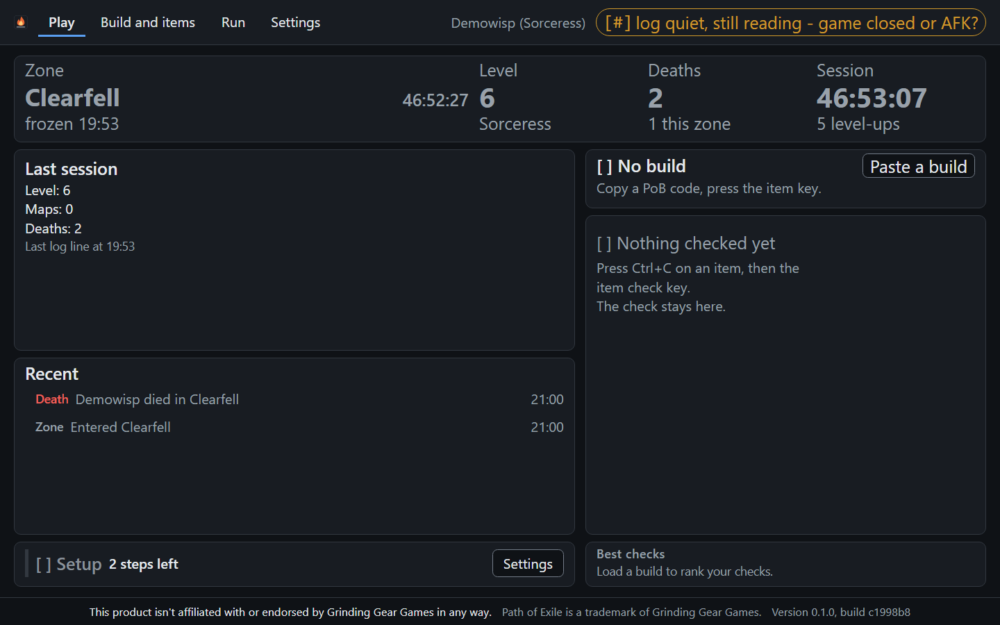
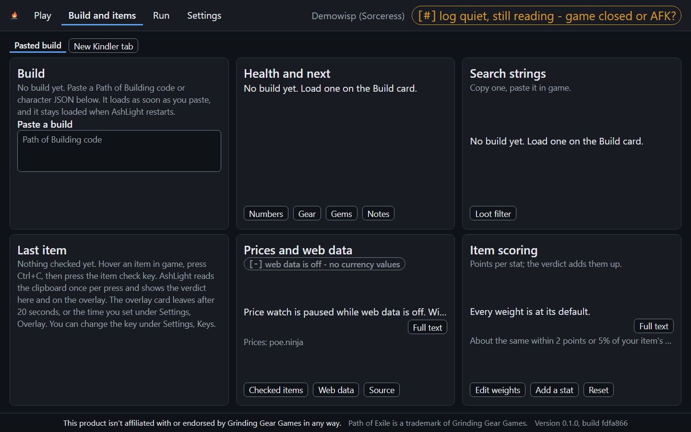
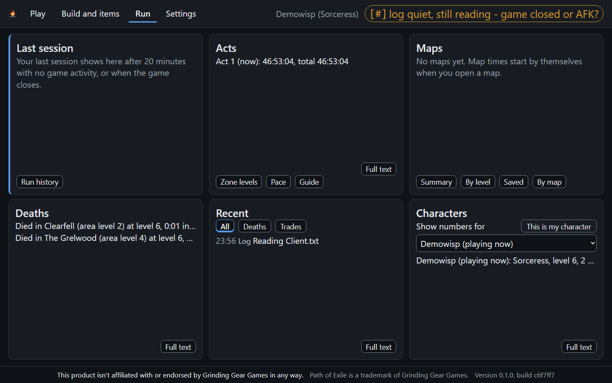
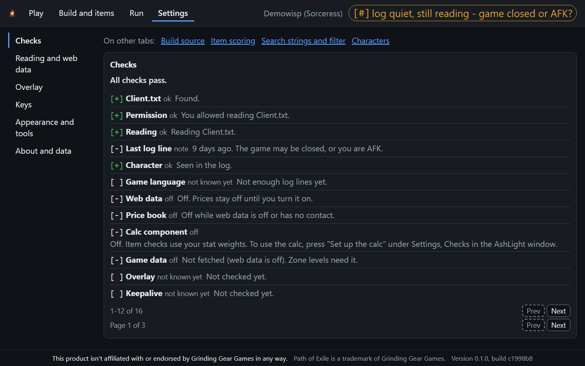
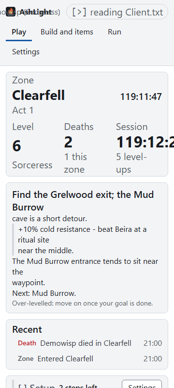
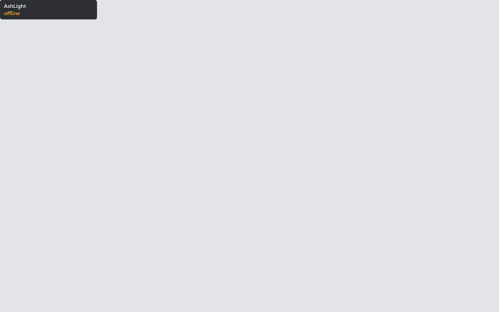

# AshLight

<picture>
  <source media="(prefers-color-scheme: dark)" srcset="assets/brand/readme-hero-dark.png">
  
</picture>

AshLight is a free, unofficial second-screen dashboard and small overlay for
Path of Exile 2 on Windows. It reads the game's own log file (`Client.txt`)
and shows the zone you are in and your time there, your level, deaths, and
incoming whispers and trade requests, and it checks items against your Path of
Building build.

It is for players who want a live view on a second screen without any tool
touching the game. It runs on your own computer, on `127.0.0.1` only, never
touches the game process and never sends input to the game.

Status: no release yet. [Install from source](#quick-start-windows) takes
about 5 minutes. See also [what AshLight never does](#what-ashlight-never-does).

**Links**

- Player guide: [download](docs/guide/download.md),
  [quick start](docs/guide/quick-start.md),
  [common issues](docs/guide/common-issues.md) and [FAQ](docs/guide/faq.md).
- Releases: none yet. AshLight releases appear at
  github.com/Remus3/AshLight/releases.
- Source: [github.com/Remus3/AshLight](https://github.com/Remus3/AshLight);
  security policy in [SECURITY.md](SECURITY.md); how to help in
  [CONTRIBUTING.md](CONTRIBUTING.md).

<!-- shots:begin -->
## Screenshots

AshLight's own pages, rendered from an invented demo session (no game
footage, no game art). They follow your light or dark setting.

<picture>
  <source media="(prefers-color-scheme: dark)" srcset="docs/shots/play-dark-1440.png">
  
</picture>

<picture>
  <source media="(prefers-color-scheme: dark)" srcset="docs/shots/build-dark-1440.png">
  
</picture>

<picture>
  <source media="(prefers-color-scheme: dark)" srcset="docs/shots/run-dark-1440.png">
  
</picture>

<picture>
  <source media="(prefers-color-scheme: dark)" srcset="docs/shots/settings-dark-1440.png">
  
</picture>

<picture>
  <source media="(prefers-color-scheme: dark)" srcset="docs/shots/play-dark-360.png">
  
</picture>
<picture>
  <source media="(prefers-color-scheme: dark)" srcset="docs/shots/overlay-dark-1440.png">
  
</picture>
<!-- shots:end -->

## What AshLight never does

- It never reads or writes game memory, injects anything, hooks graphics, or
  touches network traffic.
- It never modifies any game file and never writes into your game folders: a
  file it makes for the game (a `.build` guide, a loot filter add-on) goes to
  your browser's downloads, and you move it yourself.
- It never sends input to the game: no keys, no mouse, no chat, no macros, not
  even a synthesized copy shortcut. You play; AshLight only reads.
- It reads `Client.txt` only after you say yes, and shows a visible
  "reading Client.txt" indicator while it does. You can stop it at any time.
- It reads the clipboard once each time you press the item check hotkey, never
  on a timer and never by watching the clipboard. It writes to the clipboard
  only when you click a Copy button.
- It never asks for or stores your account, password or session cookie.

How these promises are checked: [SECURITY.md](SECURITY.md) and
[Verify your download](#verify-your-download).

## What it shows

- Live: zone, zone timer, level, deaths and session time from the log, plus
  trade requests and whispers; the overlay shows the first ones in a small
  corner box.
- Item check: hover an item, press Ctrl+C, then the item check hotkey
  (Alt+Shift+E) for a verdict against your build, with an upgrade search and
  a trade-site link you open yourself.
- Build: paste a Path of Building code or share link to see key stats, gear,
  skills and the passive tree, or save a `.build` guide file the game can load.
- Run: act times and zone levels, maps run, a death recap, run history with
  your best act times and a last-session summary.
- Prices (web data on): poe.ninja values for items and currency, price movers
  and a price watch list.

## Get started

1. Have Windows 10 or 11 and Python (the version is in the quick start);
   Node.js is optional, for the desktop client and the in-game overlay.
2. Get the source: `git clone https://github.com/Remus3/AshLight.git`
3. Run the one setup command in [Quick start (Windows)](#quick-start-windows),
   then open AshLight from its Start Menu shortcut.

## Install (Windows)

Releases: none yet, so the line below does not work today; use
[Get started](#get-started) until then.

Open Windows PowerShell as yourself (not with "Run as admin") and paste this
one line:

```powershell
irm -UserAgent 'AshLight/0.1.0 (installer)' https://github.com/Remus3/AshLight/releases/latest/download/install.ps1 | iex   # al-version-stamp
```

It downloads the small installer of the latest release and runs it. The
installer:

- checks every file it downloads against the release's `SHA256SUMS.txt`
  before it unpacks anything, and stops with nothing installed if a hash
  is wrong or missing;
- fetches the two runtimes AshLight runs on, a private Python from
  python.org and the unmodified Electron from the Electron project's
  GitHub releases, each checked against its pinned size and SHA-256;
- installs for your user only, in `%LOCALAPPDATA%\Programs\AshLight`, and
  never asks for admin rights;
- adds an AshLight shortcut in the Start Menu and on the desktop and an
  AshLight entry in Installed apps, then opens AshLight. The first window
  asks before it reads `Client.txt`; that is the one click.

It needs about 400 MB of disk. Every request names AshLight and its
version, goes only to GitHub and python.org, and carries no cookie or
account id. The installer never looks for the game and never reads or
writes a game folder. To install somewhere else, run
`$env:AL_INSTALL_DIR = '<folder>'` in the same window before the line (a
folder inside a Steam library or the game's own folder is refused).

### Install from the release files

To check everything before anything runs, or to install offline: from the
release page, download `install.ps1`, `AshLight-<version>-app.zip`,
`release.json` and `SHA256SUMS.txt` into one folder, check them (see
Verify your download below), then run in that folder:

```powershell
powershell -NoProfile -ExecutionPolicy Bypass -File .\install.ps1 -Zip .\AshLight-<version>-app.zip
```

`-ExecutionPolicy Bypass` applies to this one command only. Your Windows
setting stays as it is. Add `-RuntimeDir <folder>` to use the two runtime
zips you downloaded yourself (the Python embeddable zip and the Electron
zip at the versions `release.json` names); they are checked against the
same pins. `-InstallDir <folder>` picks the folder and `-NoStart` installs
without opening AshLight.

## Update

Automatic update is not finished yet. For now, update by hand: paste the
install line again. It upgrades in place and keeps your settings and data.
The release-files route above, with the new release's files, does the
same. From a source copy, see Update under the quick start.

<details>
<summary>When automatic update ships</summary>

When automatic update ships, it works only with web data on. An installed
copy will look for a newer release once a day and download it. It will
check the size and SHA-256 against the release's `SHA256SUMS.txt` and
GitHub's own record of the file. It will test the new version next to the
one you run. It will switch at the next start of AshLight, at least 24
hours after the release was published. If the new version does not start,
AshLight goes back to the previous one by itself. Test versions
(pre-releases) are never offered. With web data off, AshLight checks
nothing.

</details>

## Uninstall

An installed copy: open Settings, then Apps, then Installed apps (Apps and
features on Windows 10), and choose Uninstall next to AshLight. Or run:

```powershell
powershell -NoProfile -ExecutionPolicy Bypass -File "$env:LOCALAPPDATA\Programs\AshLight\uninstall.ps1"
```

If you installed somewhere else, use that folder in place of
`$env:LOCALAPPDATA\Programs\AshLight`.

It asks nothing. It stops AshLight and removes the program, its runtimes,
the two shortcuts, the logon autostart if you turned it on, and the
Installed apps entry. Your settings and run history stay in the `data`
folder; add `-Purge` to move that to the Recycle Bin too, or `-DryRun` to
see what would go without removing anything. It ends by naming what stays.
Files you saved elsewhere yourself, such as a downloaded `.build` guide or
loot filter, are yours to delete: it never looks in your game folders.

From a source copy, see Uninstall under the quick start.

## Verify your download

Each release is immutable: its files cannot be changed once it is
published. Three checks, each in PowerShell in the folder that holds the
files (the last two need the GitHub CLI, `gh`):

1. Hashes. It shows the file arrived whole: run
   `Get-FileHash .\AshLight-<version>-app.zip -Algorithm SHA256` and check
   that the hash it prints equals the zip's line in `SHA256SUMS.txt`. Do
   the same for `install.ps1` and `release.json`.
2. Build attestation. It shows the project's release workflow built the
   file from the tagged source:
   `gh attestation verify .\AshLight-<version>-app.zip --repo Remus3/AshLight`
3. Release asset. It shows the file is the one attached to that release:
   `gh release verify-asset v<version> .\AshLight-<version>-app.zip --repo Remus3/AshLight`

The installer makes the first check by itself. It cannot make the other
two; `SECURITY.md` says what it does verify.

## Windows may warn

Only needed once a release exists; a source install shows none of these.

AshLight is not code-signed yet, so Windows may show one of these:

- PowerShell execution policy: the pasted line runs without touching it.
  The release-files route and the uninstall command pass
  `-ExecutionPolicy Bypass` for that one command only. Your policy is not
  changed, and AshLight never asks you to change it.
- Microsoft Defender SmartScreen ("Windows protected your PC"): the pasted
  line downloads with PowerShell, which adds no download mark, so
  SmartScreen should not stop it. If it stops a file you downloaded in a
  browser, choose Don't run. Check the file (see Verify your download); if
  a hash does not match, get the file again from the release page. Or use
  the pasted line, which checks every file it downloads.
- Smart App Control (Windows 11): it may block unsigned programs such as
  the AshLight desktop client. This is not tested yet. If it blocks
  AshLight, there is no fix yet. Leave Smart App Control as it is.
- User Account Control: AshLight never asks for admin rights. A
  User Account Control prompt during the install does not come from
  AshLight; choose No.
- Windows Defender Firewall: AshLight listens on `127.0.0.1` only, so no
  firewall prompt is expected. If one appears for AshLight, choose Cancel;
  AshLight needs no access from other computers.
- Microsoft Defender Antivirus: it may scan the new files the first time.
  Let it finish; AshLight needs no exclusion.

## Quick start (Windows)

Needs Python 3.11 or newer. For a new install take 3.13 or newer, because
python.org has no Windows installer for 3.11 or 3.12 any more.
Node.js 22.12.0 or newer is only needed for the optional overlay. Releases: none
yet, so AshLight runs from a copy of this repository's source. One command sets
it up:

```powershell
powershell -ExecutionPolicy Bypass -File scripts\setup.ps1   # checks, folders, desktop client packages, shortcut
```

Then start AshLight from its shortcut: setup puts an "AshLight" shortcut in
the Start Menu and on the desktop (when Node.js is installed; `-NoShortcut`
skips it). Starting it is one click. It starts the core and opens the
AshLight desktop client: the companion window with the dashboard, a tray icon
and the in-game overlay. Closing the window with X keeps AshLight running in
the tray; click the tray icon to bring the window back. Right-click the tray
icon for the menu: Minimize or Restore AshLight, Show in-game overlay, Open
AshLight when the game wakes, Restart overlay and Quit AshLight.

With the opt-in logon autostart (below), AshLight starts in the tray at
logon with no window and no click; the overlay appears once the game is
running.

The same starts from a terminal, also without Node.js:

```powershell
powershell -ExecutionPolicy Bypass -File scripts\run.ps1              # core, supervisor and the desktop client (the browser dashboard without the client)
powershell -ExecutionPolicy Bypass -File scripts\run.ps1 -NoOverlay   # no client, so no overlay: the dashboard opens in the browser
powershell -ExecutionPolicy Bypass -File scripts\run.ps1 -NoBrowser   # no window at all: the core and supervisor only
```

Every script is safe to run again: a finished step is skipped, and `run.ps1`
starts only the parts of AshLight that are not already running. A keepalive
supervisor restarts the core if it dies; a stop from the tray or `stop.ps1`
is one it respects.

Optional extras:

- `scripts\setup.ps1 -TcCalc` (or `"tc_calc": true`) fetches the optional
  calc component (Path of Building PoE2 source and LuaJIT, hash-pinned) for
  full build numbers in item checks. Off by default.
- `scripts\autostart.ps1 -Enable` starts AshLight in the tray at logon (a
  current-user scheduled task; no window, and the overlay appears once the
  game is running); `-Disable` removes it. Off by default.

Logs, caches and build output go to the AshLight sidecar folder (printed by
`python -m server.al.paths` as `sidecar`; the `AL_SIDECAR_ROOT` environment
variable moves it), never into the repository's tracked files or the drive
root.

Without the scripts:

```text
python -m server.al                     # start; prints the dashboard link
python -m server.al --log PATH          # point at a Client.txt yourself
python -m server.al --no-tail --replay tests/fixtures/client_sample.txt   # demo data
```

Open the printed link (it carries a one-time access token after `#token=`).
The overlay toggles with Alt+Shift+A by default. Play in Windowed Fullscreen
so the overlay can sit on top of the game.

Optional per-computer settings live in `config/local.json` (not tracked;
`setup.ps1` copies `config/local.example.json` once):
`client_log` (path to Client.txt or the game folder), `character` (the name to
track), `overlay_toggle` and `eval_hotkey` (the overlay and item check
shortcuts), `port` (default 8960),
`web_data` (the web-data opt-in, default `false`), `league` (optional league
for prices), `contact` (how poe.ninja and GGG can reach you, sent in the
User-Agent; without it price fetches stay off) and `tc_calc` (the optional
calc component).

### Stop

Right-click the AshLight tray icon and choose Quit AshLight: it stops the
core, the supervisor and the overlay. Closing the window with X does not
stop AshLight. Without the client, or from a terminal:

```powershell
powershell -ExecutionPolicy Bypass -File scripts\stop.ps1    # stops every AshLight process
```

### Update

Releases: none yet, so an update is a source update. Quit AshLight, run
`git pull` in your copy of the repository, run the setup command above again
(it redoes only what changed and keeps your settings), then start AshLight
from its shortcut.

### Uninstall

Run the uninstall script from your copy of the repository:

```powershell
powershell -ExecutionPolicy Bypass -File scripts\uninstall.ps1 -Checkout
```

It asks nothing. It stops AshLight, then removes the logon autostart if you
turned it on and the two AshLight shortcuts, in the Start Menu and on the
desktop, when they point into this copy. It deletes no file by itself. Add
`-DryRun` to see what it would do without changing anything, or `-Purge` to
also move your settings in `config/local.json` and your run history in
`ops/runtime/` to the Recycle Bin and delete the caches, logs and build
output in the sidecar folder; `-Purge` asks once for the typed word PURGE.
It ends by naming what stays. Then delete the repository folder yourself.
The sidecar folder (`python -m server.al.paths` prints it as `sidecar`) is
left in place; delete it too if you no longer want it.

### Troubleshooting

- Something missing or wrong: open the dashboard's Settings tab and the
  Checks list. Each failing check names its fix. Copy report copies a short
  plain-text report with no file paths, names, contact or chat in it; paste
  it where you ask for help.
- Port 8960 taken by another program: set `"port"` in `config/local.json`
  to another port in 8960-8979 (the shortcut and the scripts both read it),
  or start once with `scripts\run.ps1 -Port 8961`. The `AL_PORT` environment
  variable works too.
- The overlay does not show over the game: play in Windowed Fullscreen,
  check that Show in-game overlay is ticked in the tray menu, and try
  Restart overlay there. The overlay hides itself after 20 minutes with no
  game activity and comes back with the next log line.

## Privacy and consent

- The first time, the dashboard asks before reading `Client.txt` and names the
  file and what is derived from it. Your answer is stored locally.
- Apart from the install you start yourself, nothing leaves your computer unless
  you turn on web data (off by default). With it on, AshLight fetches currency
  and item prices from poe.ninja at most once an hour and a build share link
  (pobb.in, pastebin) once when you paste it; every request names AshLight and
  its version and carries no cookie or account id.
- Game data (zone levels, item bases and mods, the passive tree) also needs web
  data. Once it is on, AshLight downloads that data by itself when it starts,
  and again when the copy is a day old: a small hidden helper at low priority
  fetches the public community export (repoe-fork) and, with your contact set,
  GGG's passive tree export into AshLight's own folder on this computer. You do
  nothing else, and nothing is fetched while web data is off.
- It never asks the trade site anything: the trade link after an item check
  opens in your own browser only when you click it.
- When automatic update ships (see Update), an installed copy with web data on
  will read the project's latest release on GitHub once a day, to learn whether
  a newer version is out. It is not made yet. The request will name AshLight and
  its version and carry no contact, cookie or account id; with web data off it
  is never made.
- The server binds `127.0.0.1` only; every API call needs the per-start token;
  the Host and Origin headers are checked; the dashboard runs under a strict
  Content Security Policy.
- The log can hold chat text. AshLight keeps only a short in-memory list of
  recent whispers and events and writes none of it to disk. Run history is
  kept on this computer only while its box is ticked, and can be cleared.

## Budgets

For developers: the performance budgets the test suite enforces.

AshLight must never cost you frames. The tested budgets:

- Core: parses 10,000 log lines in under 250 ms; a 1,000-line burst in under
  50 ms; idle tailing under 0.5 percent of one CPU core for the whole core
  loop, tailer included, and under 1 percent with the dashboard and overlay
  streams open; memory stays flat (every buffer is bounded).
- Overlay: no animation and no render loop - it draws only when a shown value
  changes; hardware acceleration off; idle CPU under 1 percent of one core;
  under 250 MB for all its processes.

## Contributing

Issues are welcome. Pull requests are proposals; nothing is merged on GitHub,
and the maintainer re-applies accepted changes locally. See
[CONTRIBUTING.md](CONTRIBUTING.md).

## How it works

For developers: how the core, the dashboard and the overlay fit together.

The core is a small Python program using only the standard library. A tailer
polls the size of `Client.txt` four times a second and reads only the new
bytes. At start it looks back through the log only to pick up the current
run (zone, level, deaths), so an old session is never replayed. A parser
turns each line into an event (zone change, level up, death, whisper, trade
request, ...). Events go through an in-process event bus into a session
state, and a local HTTP server pushes that state to the dashboard over
Server-Sent Events, coalesced to at most four updates a second.

The dashboard is plain HTML, CSS and JavaScript served by the core. The
overlay is a separate Electron window that is transparent, always on top,
click-through and never takes focus; it shows the same feed in a tiny corner
box. Build numbers come from Path of Building PoE2: the ones saved in your
build code, and more when the optional calc component runs it unmodified as a
separate process. AshLight has no damage calculator of its own.

## How this repository is run

AshLight is built by one maintainer with AI coding assistants. The files
`CLAUDE.md`, `AL-NEXT-SESSION.txt` and `ROADMAP.md` and the folders `ops/` and
`docs/` are that development process: the assistants' rules, the hand-off
between work sessions, the work list, research notes and decision records. You
can ignore them to use AshLight or to read its code.

The process is AI-assisted and operator-reviewed: the maintainer reviews every
change, and every commit is gated by the test suite, an identity check (no bot
author and no AI co-author line) and a leak sweep (no machine path, account id
or e-mail address in any tracked file).

The development loop, not the app, reads a few public web pages unattended:
once a day the Path of Building PoE2 releases list (decision 0025) and GGG's
developer documentation pages (decision 0044). The app itself fetches nothing
unless you turn web data on.

Releases: none yet, install from source (see the quick start above).

## Disclaimer

This product isn't affiliated with or endorsed by Grinding Gear Games in any way.

Path of Exile is a trademark of Grinding Gear Games.

## License

Apache-2.0. See [LICENSE](LICENSE) and [NOTICE](NOTICE).
